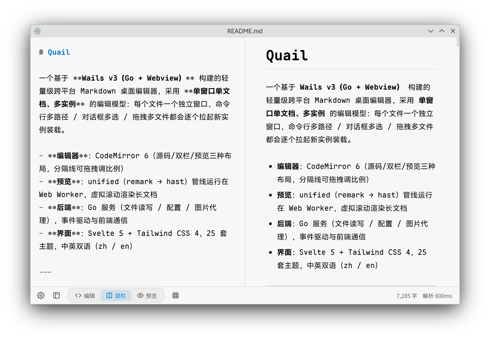

# Quail



---

## 目录

- [功能特性](#功能特性)
- [技术栈](#技术栈)
- [项目结构](#项目结构)
- [架构总览](#架构总览)
- [后端实现](#后端实现)
  - [三个服务与生命周期](#三个服务与生命周期)
  - [文件服务 FileService](#文件服务-fileservice)
  - [配置服务 ConfigService](#配置服务-configservice)
  - [图片代理 ImgProxy](#图片代理-imgproxy)
  - [编码检测与转码](#编码检测与转码)
  - [自身写入抑制 writeGuard](#自身写入抑制-writeguard)
  - [窗口状态记忆](#窗口状态记忆)
  - [事件协议](#事件协议)
- [前端实现](#前端实现)
  - [桥接层 bridge.ts](#桥接层-bridgets)
  - [全局状态与解析管线](#全局状态与解析管线)
  - [预览渲染与虚拟滚动](#预览渲染与虚拟滚动)
  - [双向同步滚动](#双向同步滚动)
  - [设置存储](#设置存储)
  - [国际化](#国际化)
  - [快捷键](#快捷键)
- [数据与文件位置](#数据与文件位置)
- [开发与构建](#开发与构建)
- [测试](#测试)
- [安全设计要点](#安全设计要点)

---

## 功能特性

### 编辑与预览

- **三种布局**：`source`（纯编辑）/ `split`（双栏）/ `preview`（纯预览），可设置启动默认布局（`memory` 记住上次 / 固定指定）；
- **Markdown 渲染**：GFM（表格、任务列表、删除线）、脚注、自动锚点标题、代码块高亮（highlight.js，独立 Worker）；
- **可交互预览元素**：
  - 可编辑表格（单元格内嵌 CodeMirror 编辑器，Ctrl+Enter / 失焦提交，回写源码）；
  - 可勾选任务复选框（勾选状态回写源码）；
  - 折叠面板（`<details>` → Accordion，折叠状态按内容指纹记忆）；
  - 图片右键菜单：用系统程序打开 / 另存为；
- **查找替换**：右上角悬浮面板，全布局可用（预览模式无需切回双栏）；
- **大纲面板**：标题树 + 关键词过滤，点击跳转，滚动自动追踪；
- **双向同步滚动**：编辑器 ↔ 预览按"块 + 块内像素插值"对齐，带程序化滚动抑制与光标同步待办，防回环防丢事件；
- **字数统计**：字符 / 单词 / 字词混合三种口径（混合口径单位随界面语言）。

### 文档管理

- **多实例模型**：打开新文件时，若当前实例是"未命名空白文档且无编辑记录"则原地装载，否则拉起新窗口装载（每文件一窗口）；
- **打开通道**：系统对话框（可多选）/ 文件拖入窗口 / 命令行参数；
- **编码支持**：自动检测 BOM、UTF-8/16、GBK、Shift-JIS、Latin 系等各国文本编码，读入统一转 UTF-8，保存按原编码写回；二进制文件静默拒绝；
- **外部变更感知**：fsnotify 目录监听（300ms 防抖），文件被外部修改 → 顶部横幅提示"重新加载 / 忽略"；被外部删除 → 横幅提示"另存为 / 忽略"，保存路由到"确认重建"流程；
- **保存安全**：同目录临时文件 + rename 的原子写，保留文件权限与 BOM；保存前以 sha256 检测外部修改冲突，冲突弹确认、不覆盖磁盘；
- **脏状态守卫**：关闭窗口 / Ctrl+Q / Cmd+Q 全部路径先由前端判定脏状态 → 三选确认（保存 / 丢弃 / 取消）；窗口标题带 `*` 星号标记。

### 设置与外观

- 25 套主题（ayu、Dracula、Nord、Catppuccin、Gruvbox、Rose Pine、Vitesse 等）；
- 编辑区 / 预览区独立字体与字号；
- 缩进单位（Tab / 2 空格 / 4 空格）运行时经 CodeMirror Compartment 热切换；
- 界面语言：跟随系统 / 中文 / English；
- 配置存于系统配置目录（`settings.json`），多窗口共享并支持外部修改热重载。

---

## 技术栈

| 层 | 技术 |
|---|---|
| 桌面壳 | [Wails v3](https://v3.wails.io/) v3.1.0（Go 1.26 + 系统 WebView） |
| 后端 | Go 1.26；`fsnotify`（文件/配置监听）、`saintfish/chardet`（编码探测）、`golang.org/x/text`（编码转换）、`golang.org/x/sync/singleflight`（并发下载去重） |
| 前端框架 | Svelte 5（runes：`$state` / `$effect`）+ TypeScript + Vite 8 |
| 样式 | Tailwind CSS 4 |
| 编辑器 | CodeMirror 6（`@codemirror/*` 全家桶） |
| Markdown | unified 11：`remark-parse` + `remark-gfm` + `remark-slug` → `mdast-util-to-hast` + `hast-util-raw` + `hast-util-to-html`，`rehype-sanitize` 清洗 |
| 代码高亮 | highlight.js 11（Web Worker 着色） |
| 国际化 | svelte-i18n |
| 测试 | 前端 Vitest；后端 Go 原生 testing |
| 构建 | Taskfile + `wails3 dev` / `wails3 build`，支持 Windows / macOS / Linux（含 iOS、Android 目标 Taskfile） |

---

## 项目结构

```
quail/
├── main.go                 # 应用入口：Wails 组装、窗口创建、关闭拦截链、File Drop
├── app_service.go          # AppService：Ready / 关闭请求 / 确认退出 / 新实例
├── file_service.go         # FileService：打开/保存/另存/监听（文档状态机）
├── config_service.go       # ConfigService：配置持久化与监听广播
├── image_actions.go        # 图片右键菜单后端支撑（路径解析/下载/另存）
├── imgproxy.go             # AssetServer 中间件：/__imgproxy/* 图片代理
├── encoding.go             # 编码检测与磁盘字节 ↔ UTF-8 转码
├── write_guard.go          # 自身写入抑制（写入令牌 + 内容哈希）
├── window_state.go         # 窗口尺寸记忆（$XDG_STATE_HOME/quail）
├── events.go               # 事件名枚举 + payload 模型（生成 TS bindings）
├── *_test.go               # Go 单测（编码/文件/代理/写守卫）
├── tools/licgen/           # 许可证列表生成小工具
├── Taskfile.yml            # 任务入口（build/package/dev/run，按平台分发）
├── build/                  # 平台构建配置（windows/darwin/linux/ios/android）
└── frontend/
    ├── package.json        # 前端依赖与脚本（dev/build/check/test）
    ├── src/
    │   ├── App.svelte          # 根组件：布局、快捷键分发、同步滚动、保存/打开分流
    │   ├── main.ts             # 入口
    │   ├── themes.css          # 25 套主题 CSS 变量
    │   ├── app.css             # 全局样式
    │   ├── components/         # 通用 UI：BottomBar / OutlinePanel / SettingsModal /
    │   │                       #   ConfirmDialog / ContextMenu / Toast / Banner /
    │   │                       #   ParseStatus / TableInsertPopover 等
    │   ├── lib/
    │   │   ├── bridge.ts           # Wails 桥接层（bindings 封装 + 外链校验）
    │   │   ├── stores.ts           # 全局状态中心 + 解析调度器 + bootApp
    │   │   ├── settings.ts         # 设置 KV 抽象（后端配置为唯一事实源）
    │   │   ├── confirm.ts          # 确认弹窗
    │   │   ├── i18n.svelte.ts      # svelte-i18n 初始化（zh/en，system 探测）
    │   │   ├── i18n-messages.ts    # 中英文消息表
    │   │   ├── themes.ts           # 主题变量注入与字体链
    │   │   ├── imgproxy.ts         # 代理 URL 构造
    │   │   ├── banner.ts / contextmenu.ts / docpath.ts / focusTrap.ts / licenses.ts
    │   │   ├── markdown.ts         # 兼容再导出层（主线程纯函数）
    │   │   ├── editor/             # CodePane.svelte、codemirrorSetup.ts、
    │   │   │                       #   searchPanel.ts、emphasis.ts
    │   │   ├── markdown/           # 渲染组件（MarkdownNode/Segment、EditableTable、
    │   │   │                       #   EditableCheckbox、Accordion、图片/链接/脚注）
    │   │   │                       #   + blocks.ts（块映射/统计纯函数）、table-ops 等
    │   │   ├── preview/            # PreviewPane.svelte + 预览查找
    │   │   ├── virtual/            # VirtualList.svelte（虚拟滚动）
    │   │   ├── highlight/          # highlight.js Worker（protocol / hl-client / CodeBlock）
    │   │   └── worker/             # 解析 Worker（parse / full / protocol / client / dom-shim）
    │   └── test/setup.ts       # Vitest 配置
    └── dist/               # 构建产物（Go embed 打进二进制）
```

---

## 架构总览

```
┌─────────────────────────── 窗口（WebView） ───────────────────────────┐
│  Svelte 5 前端                                                        │
│  App.svelte ──► CodePane(CM6) + PreviewPane(VirtualList) + 组件层     │
│        │                                                             │
│        ├─ bridge.ts ── bindings（wails3 generate bindings 生成 TS）    │
│        ├─ stores.ts ── 解析调度器（200ms 防抖 + IME 闸门 + 背压）        │
│        │       ├─ parse.worker（增量解析，段级补丁）                    │
│        │       ├─ full.worker（例行全量重建，并行）                     │
│        │       └─ highlight.worker（代码着色）                         │
│        └─ Events.On（file:changed / file:deleted / file:dropped /     │
│                    config:changed / close:request）                   │
└──────────────────────────────┬────────────────────────────────────────┘
              bindings 调用 │ ▲ 事件广播
┌──────────────────────────────┴────────────────────────────────────────┐
│  Go 后端（Wails v3）                                                   │
│  AppService / FileService / ConfigService（导出方法自动绑定前端）        │
│  ImgProxyMiddleware（/__imgproxy/local|remote，AssetServer 中间件）     │
│  fsnotify：文档目录监听 + 配置目录监听                                   │
│  encoding（chardet + x/text） / writeGuard（哈希核对防回环）             │
└────────────────────────────────────────────────────────────────────────┘
```

前后端职责划分明确：**后端不保存、不询问脏状态**——所有关闭路径（窗口关闭按钮 / Ctrl+Q / Cmd+Q）被后端拦截钩子取消后，仅向前端广播 `close:request`，由前端判定脏状态后决定 `ConfirmQuit` 或取消。文档装载、编辑器替换、打开分流等 UI 决策同样全部在前端。

---

## 后端实现

### 三个服务与生命周期

`main.go` 组装应用：

- **AssetServer**：静态资源（Go `embed` 打包 `frontend/dist`）+ `ImgProxyMiddleware` 中间件拦截 `/__imgproxy/*` 路径；
- **Services**：`AppService` / `FileService` / `ConfigService`，导出方法经 `wails3 generate bindings` 自动生成 TypeScript 供前端调用；
- **主窗口**：初始 `Hidden: true` 启动，前端首帧就绪后调用 `AppService.Ready()` 显示（消除白屏闪烁）；默认 1280×800，最小 720×480；
- **关闭拦截链**（双通道）：
  - 窗口关闭按钮 → `WindowClosing` Hook：未确认退出则 `e.Cancel()` 取消关闭并 `RequestClose()`（发 `close:request`）；
  - 应用级退出（Ctrl+Q / Cmd+Q）→ `ShouldQuit`：同样逻辑，未确认返回 `false` 阻止退出；
  - 前端确认后调用 `ConfirmQuit()` 置位 `confirmed`（`atomic.Bool`），此后两条通道全部放行；
- **File Drop**：`EnableFileDrop: true` + `WindowFilesDropped` 事件 → 文件绝对路径列表打包为 `file:dropped` 事件转发前端。

`AppService` 方法一览：`Ready`（显示窗口）、`SetTitle`（标题同步，脏状态加 `*`）、`RequestClose`（发 close:request）、`ConfirmQuit`（置位确认并真正退出）、`CloseWindow`（Ctrl+Q 入口，语义等同窗口关闭）、`NewInstance`（拉起新进程；macOS 下在 .app 包内时改走 `open -n` 以保留 Bundle 上下文）。

### 文件服务 FileService

文档状态机（`docStatus` 只存路径与指纹，不复制内容进内存）：

- **`StartupFiles`**：启动时装载命令行文件列表——首个有效文件装载为当前文档，其余路径原样返回，由前端逐个拉起新实例；无路径则返回空文档，不弹对话框；
- **`Open(path)`**：读盘 → 编码检测转 UTF-8（原编码名记入 `DocState.Encoding`）→ 过滤二进制（非文本静默丢弃）→ 持有 `path / encoding / bom / lastKnown(sha256)` → 启动 fsnotify 目录监听，过滤出当前文档的变动，300ms 防抖合并后广播 `file:changed`（携带转码后的新内容）或 `file:deleted`；
- **`Save(content, force)`**：sha256 对比 `lastKnown` 检测外部修改冲突（冲突返回 `SaveResult{Conflict:true}`，不覆盖磁盘；`force=true` 跳过校验用于确认覆盖/重建场景）→ 原子写：**同目录临时文件 + fsync + rename**，保留原文件权限，原文件带 BOM 则补写；
- **`SaveAs(path, content)`**：原子写新路径并把目录监听迁移过去；
- **`CloseDoc`**：停止监听、清空文档状态；
- 系统对话框不再经 Go 绑定暴露：前端经运行时 `Dialogs` 模块（`@wailsio/runtime`）弹出，窗口模态；
- 图片动作（见 `image_actions.go`）：`ImageFilePath`（把 imgproxy 代理 URL 解析为磁盘绝对路径；远程图未命中缓存先经 singleflight 下载）、`ImageSaveFile`（源文件字节在后端读取并原子写入，**不经前端往返**）、`OpenFileWithExternal`（系统默认程序打开）。

### 配置服务 ConfigService

- 配置目录：`os.UserConfigDir()/quail`（Linux `~/.config/quail`、macOS `~/Library/Application Support/quail`、Windows `%AppData%/quail`），文件 `settings.json` 原子写；
- **Config 字段**：`mode / defaultLayout / theme / locale / indent / countMode / fontEditor / fontPreview / fontSizeEditor / fontSizePreview`，出厂默认 split 布局 + ayu-dark 主题 + 混合字数统计；
- **`Get` / `SaveFields`**：`SaveFields` 接收前端提交的脏字段，与磁盘最新配置**按字段合并**（多窗口互不覆盖）；
- **监听**：fsnotify 监听配置目录，`settings.json` 被外部修改（含用户手改、其他窗口保存）时 300ms 防抖后广播 `config:changed` 并携带新配置；前端以此实现多窗口设置实时同步；
- 前端设置以后端配置文件为**唯一事实源**（历史 localStorage 只做一次性迁移，现已移除）。

### 图片代理 ImgProxy

AssetServer 中间件，前端 `<md-image>` 统一指向两条代理路径：

- **`/__imgproxy/local?p=<相对或绝对路径>`**（本地文档目录资源）：白名单严格限定——已打开文档时仅允许文档所在目录本身及其 `assets/` 子目录；越权、路径逃逸（`../`）、文档未保存一律 `403` JSON 错误（前端 error 态展示"访问受限"）；
- **`/__imgproxy/remote?url=<encoded URL>`**（远程资源）：仅 http/https；15s 超时；20MB 上限；校验 `Content-Type` 为 `image/*`；缓存于系统缓存目录（key = sha256(url)），原子写入，命中直回。

### 编码检测与转码

`encoding.go`：读盘时先探测 BOM，再用 chardet 启发式检测，统一转 UTF-8 交给前端；写回按 `DocState.Encoding` 把 UTF-8 编码回原编码（无法映射的字符替换为 `?`，utf-8 直写）。EOL 统一策略：读入时 CRLF/CR 归一化为 LF，内存与落盘恒为 LF（CM6 内部即以 `\n` 分行），不做 EOL 还原。支持 charmap / 日文 / 韩文 / 简繁中文 / UTF-16 等大类。

### 自身写入抑制 writeGuard

`FileService` 与 `ConfigService` 共用的防回环机制。旧方案"时间窗布尔标记"存在两类误判（防抖耗时超出窗口 → 自身写入被广播；窗口内外部恰好写盘 → 丢更新）。新方案：

1. 每次自身写入先登记唯一令牌 + 落盘内容 sha256；
2. watch 防抖触发时读盘核对哈希——命中登记 → 判定自身写入回环，抑制广播并清除令牌；未命中 → 外部修改，放行广播；
3. 令牌带 10s TTL，监听降级场景过期自动清理。

### 窗口状态记忆

主窗口尺寸持久化到 `$XDG_STATE_HOME/quail/window.json`（Windows 回退 `%LOCALAPPDATA%/quail/state`）。与用户配置刻意分离（窗口几何属会话状态，不触发 `config:changed` 广播）。resize 事件 300ms 防抖合并写入；`WindowClosing` 时同步落盘兜底；记录低于最小尺寸视为无效，回退出厂默认。

### 事件协议

`events.go` 集中定义全部后端 → 前端事件（`EventType` 命名类型常量，bindings 生成器自动产出 TS 枚举）：

| 事件 | 载荷 | 说明 |
|---|---|---|
| `file:changed` | `FileEventData{path, content}` | 文档被外部修改（content 为转码后 UTF-8 新内容） |
| `file:deleted` | `FileEventData{path}` | 文档被外部删除/移走 |
| `file:dropped` | `FileDroppedEventData{files[], target}` | 文件拖入窗口（Wails File Drop 官方通道） |
| `config:changed` | `ConfigEventData{config}` | 配置变更（外部修改 / 其他窗口保存） |
| `close:request` | — | 关闭请求已发出，请前端判定脏状态 |

---

## 前端实现

### 桥接层 bridge.ts

前端唯一的后端访问入口，全部静态 import 生成的 bindings（构建期解析打包）：

- 封装三个服务的所有调用（`ready / setTitle / requestClose / confirmQuit / closeWindow / newInstance`、`startupFiles / pickOpenPaths / openDocument / saveDocument / saveAsViaDialog`、`loadConfig / persistConfigFields`、图片动作）；
- **外链白名单**：`openExternal` 仅放行合法 http/https；显式携带其他 scheme（`file:` / `javascript:` / `data:` 等）一律拒绝；未携带协议的裸域按 https 补全后复验，仍非法则静默忽略——不转发任何未校验内容到系统层；
- 系统对话框经运行时 `Dialogs` 模块（`@wailsio/runtime`）弹出，自动附属当前窗口（窗口模态），弹窗期间 webview 不可交互。

### 全局状态与解析管线

`stores.ts` 为全局状态中心（svelte store）+ 解析调度器：

- **持久化工厂**：`persistedEnum / persistedText / persistedNumber / persistedBool` —— store 创建时读入设置快照，订阅期自动回写后端；
- **解析调度**（文档变化 → 预览更新）：
  - `doc$` 变化 → 记积压 → **200ms 防抖**（打开文档触发跳过防抖立即发送，首屏即时）；
  - **IME 闸门**：输入法组合期间永不发请求，组合结束后统一补跑（中文输入的关键体验保障）；
  - **Worker 背压**：worker 在途时积压最新内容，响应回齐后重新起防抖（worker 串行处理，乱序会让增量补丁错位）；
  - 空白文档短路：不发 worker 请求，主线程直接落地空结果；
- **双 Worker 架构**：
  - `parse.worker`：实时增量解析——维护 `IncrementalParseState`，只回传被替换区间的段级补丁，未变段对象引用保持稳定 → Svelte 按引用相等跳过子树（图片不重新请求）；
  - `full.worker`：例行周期全量重建（MessageChannel 直连 + 内容哈希去重），分批回传、主线程缓冲后原子采纳；
  - worker 崩溃自动重建并强制全量重解析（自愈）；冷启动/idle 自愈在增量 worker 内就地全量；
- **派生状态**：`counts$`（单口径字数）、`activeHeading$`（当前激活标题）、`guardDirty$`（守卫脏状态）、`parsePhase$`（parsing/idle，底栏指示器）；
- **bootApp 启动序列**：注册配置重放回调 → 加载后端配置 → 应用启动布局 → 订阅文件事件 → `StartupFiles` 装载命令行文档（多路径逐个拉新实例）→ 强制全量解析 → 下一宏任务调用 `bridgeReady()` 显示窗口（窗口显示与首帧绘制并行）。

### 预览渲染与虚拟滚动

- `markdown/markdown-core.ts` 承载解析管线（worker 线程）；主线程仅保留块映射与文本统计纯函数（零依赖，不把 unified 生态打进主 bundle）；
- `MarkdownNode / MarkdownSegment`：keyed 原地 diff 的段级渲染树，hast 清洗（`rehype-sanitize`）后生成 HTML；
- `virtual/VirtualList.svelte`：预览虚拟滚动，按需挂载——长文档只渲染视口内段落；正在编辑的表格单元格所在段被"钉住"（pinned），滚出视口也不卸载，编辑状态不丢；
- 引用快照（`reference-store.ts`）先于段落地，保证无"新段 + 旧引用"中间态。

### 双向同步滚动

`App.svelte` 中实现编辑器 ↔ 预览的双向像素级同步（`PreviewBlock` 提供块行界）：

- **两条路径**：编辑器顶行 → 预览（块索引 + 块内插值 y）；预览可见块 → 编辑器（小数行号回写）；
- **程序化滚动抑制**：程序滚动后 320ms 内不回写对方（分方向两个时间戳标记），防止回环；
- **光标同步待办**：光标事件只记录 + rAF 合并，`trySyncCursor` 幂等重试——条件不具备保留 pending（等 blocks 更新 / api 就绪 / 切回 split），抑制期间延迟 340ms 重试，不丢事件；
- **锚点策略**：编辑中（1.2s 内有光标活动）blocks 重建后用光标行对齐（35%/65% 视窗位置），滚动查看用顶行对齐——避免"跳过去又跳回来"；
- **去重**：目标落点与预览**当前实际 scrollTop** 比对（而非历史记录），修复记录式去重导致的同步冻结；
- 可见性滞回带（视窗上下 15%，上限 48px）内不干预用户滚动。

### 设置存储

`settings.ts`：后端 ConfigService 为唯一事实源的 KV 抽象。

- get/set 读写内存快照；set 记录脏字段，300ms 防抖后仅把脏字段增量回写（`SaveFields` 按字段合并，多窗口互不覆盖）；
- `config:changed` 事件 → 快照刷新 + 重放到各 store；重放期间回写不视为本地修改，本地未落盘的脏字段不被远端广播回退；
- `mode`（布局）是窗口本地状态：快照同步该字段但运行中不回放，只作为新窗口的启动默认值。

### 国际化

`i18n.svelte.ts` 基于 svelte-i18n：消息为分组嵌套 JSON（zh/en），支持 `{param}` 插值与 ICU 复数；语言设置 `system / zh / en` 持久化经设置 KV，system 探测 `navigator.language`；缺失键回退英文。CM6 phrases 随语言热重配。

### 快捷键

`window` keydown 统一分发（弹层守卫：设置面板 / confirm 弹窗打开期间阻断全部界面快捷键；系统对话框为窗口模态，弹窗期间天然无输入）：

| 快捷键 | 行为 |
|---|---|
| Ctrl/Cmd+N | 新实例（新窗口空文档） |
| Ctrl/Cmd+O | 打开（对话框 → 原地装载 / 新实例分流） |
| Ctrl/Cmd+S | 保存（CM6 聚焦时由其 keymap 处理，全局兜底防双保存） |
| Ctrl/Cmd+Shift+S | 另存为 |
| Ctrl/Cmd+F | 查找替换悬浮面板（预览模式可用，自动拉取预览选区） |
| Ctrl/Cmd+Q | 退出（语义等同窗口关闭，触发脏状态守卫） |
| Ctrl/Cmd+Z / Shift+Z / Y | 全局撤销/重做（CM6 内交给自身 keymap，原生输入控件不劫持） |

---

## 数据与文件位置

| 内容 | 位置 |
|---|---|
| 用户配置 | `os.UserConfigDir()/quail/settings.json`（Linux `~/.config/quail`） |
| 窗口尺寸 | `$XDG_STATE_HOME/quail/window.json`（Linux 默认 `~/.local/state/quail`；Windows `%LOCALAPPDATA%/quail/state`） |
| 远程图片缓存 | `os.UserCacheDir()/quail/imgs/`（key = sha256(url)） |

---

## 开发与构建

前置要求：Go 1.26+、Node.js + npm、[Wails v3 CLI](https://v3.wails.io/getting-started/installation)（`go install github.com/wailsapp/wails/v3/cmd/wails3@latest`）、[Task](https://taskfile.dev)。

```bash
# 开发模式（前端热重载 + 后端自动重建）
wails3 dev -config ./build/config.yml -port 9245    # 或：task dev

# 生产构建（产物在 build/bin）
task build            # 当前平台（wails3 build 亦可）

# 打包
task package          # 按平台分发：windows / darwin / linux

# 前端单独开发
cd frontend && npm install && npm run dev        # Vite dev server
npm run build        # 构建（先注入 build-info）
npm run check        # svelte-check 类型检查

# 重新生成前端 bindings（Go 服务方法变化后）
wails3 generate bindings
```

支持 Docker 交叉编译（`task setup:docker`）与无 GUI 的 server 模式构建（`task build:server`，见 `build/Taskfile.yml`）。

## 测试

```bash
# Go 后端单测（编码检测转码 / 文件服务 / 图片代理 / 写守卫）
go test ./...

# 前端单测（Vitest；解析管线 / 块映射 / 表格操作 / 组件测试）
cd frontend && npm test
```

---

## 安全设计要点

- **文件访问白名单**：imgproxy 本地资源仅限当前文档目录及其 `assets/` 子目录，路径逃逸与越权一律 403；
- **外链白名单**：仅 http/https 转发系统浏览器，其他 scheme 前端即拦；
- **预览消毒**：hast 渲染经 `rehype-sanitize` 清洗；
- **写盘一致性**：临时文件 + fsync + rename 原子写，保存前 sha256 冲突检测，不静默覆盖外部修改；
- **脏状态全拦截**：所有退出/关闭/替换路径统一走前端守卫确认，后端不做任何静默保存或退出；
- **字节后端通道**：图片另存为等文件字节操作在后端完成，不经前端往返。
