# Mermaid 渲染测试文档

本文档用于测试 Markdown 渲染器对 Mermaid 图表代码块的支持。

## 1. 流程图 Flowchart

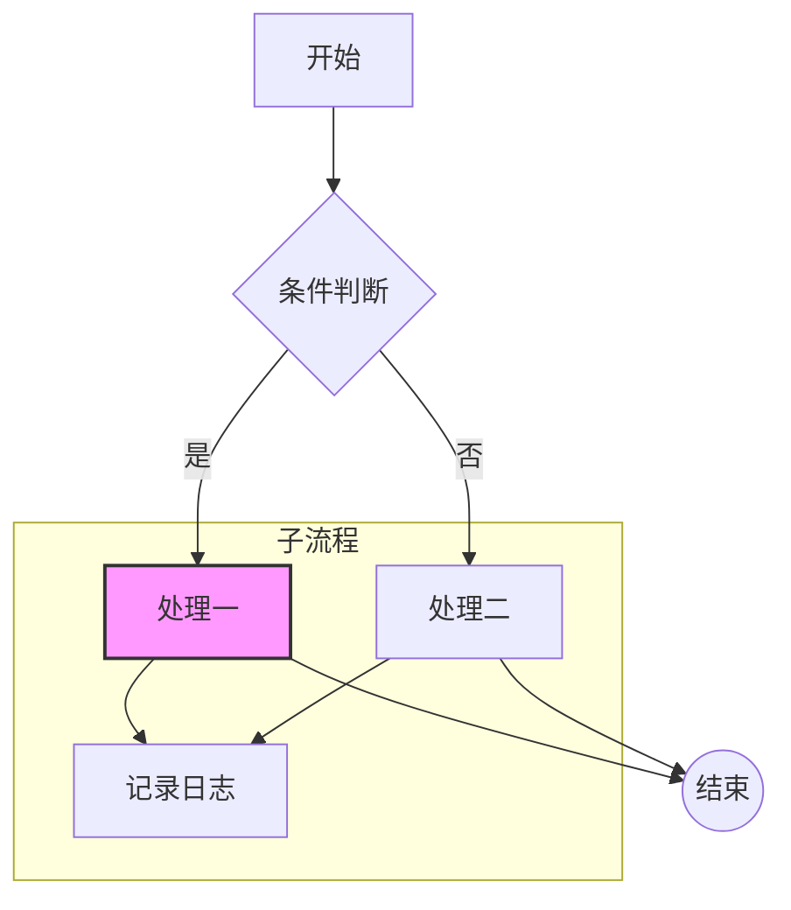

## 2. 时序图 Sequence Diagram

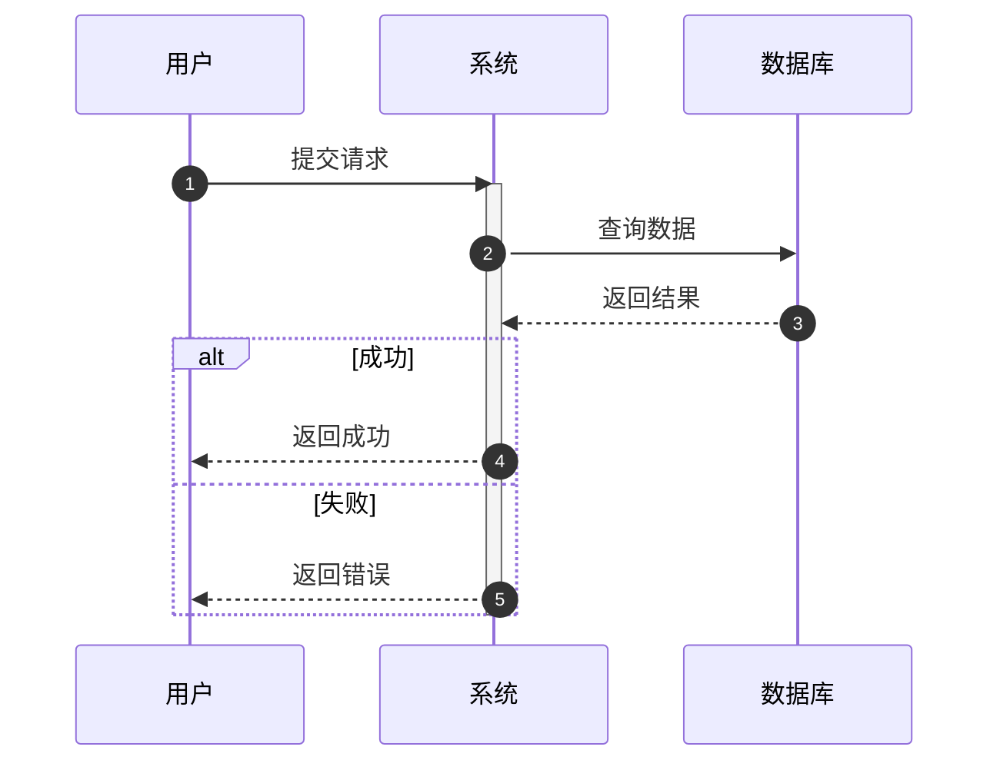

## 3. 类图 Class Diagram

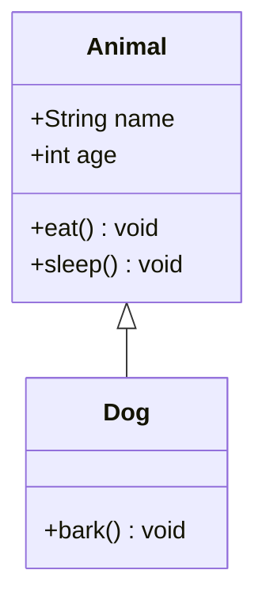

## 4. 状态图 State Diagram

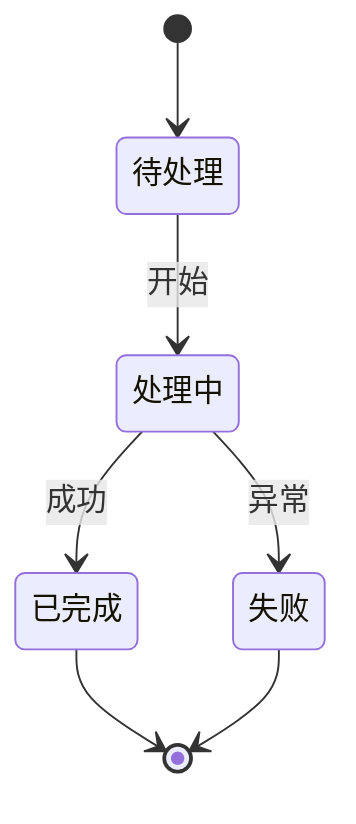

## 5. ER 图 Entity Relationship Diagram

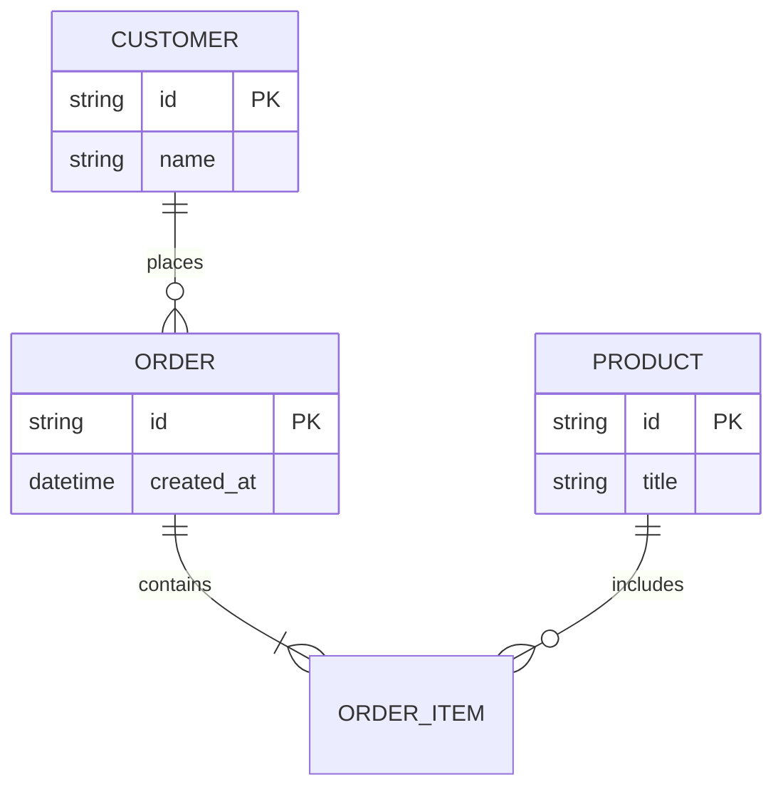

## 6. 甘特图 Gantt

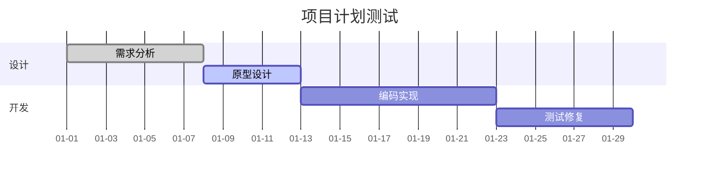

## 7. 饼图 Pie

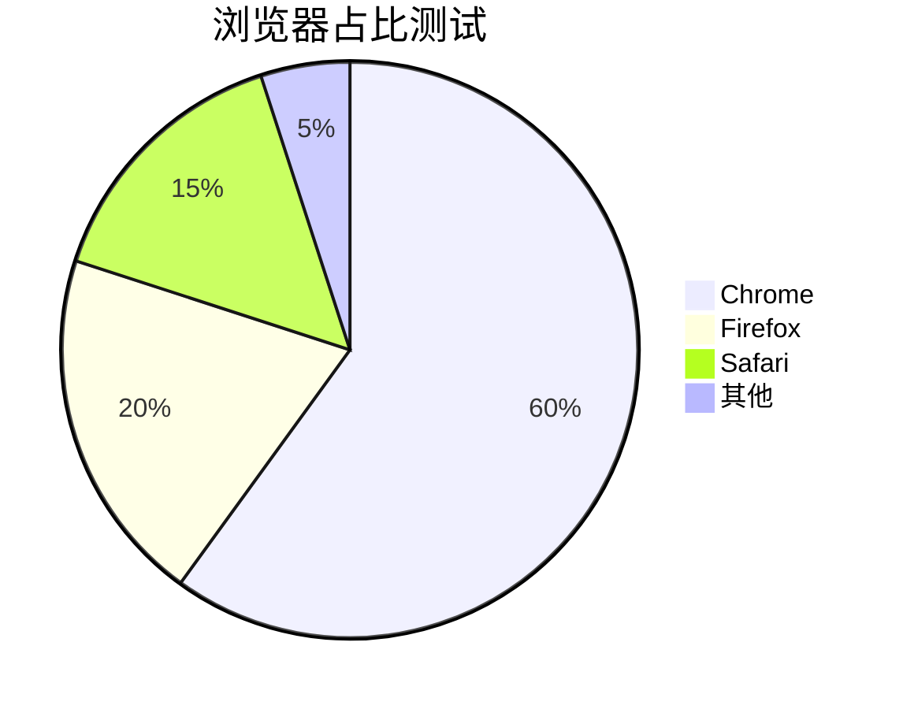

## 8. 用户旅程图 Journey

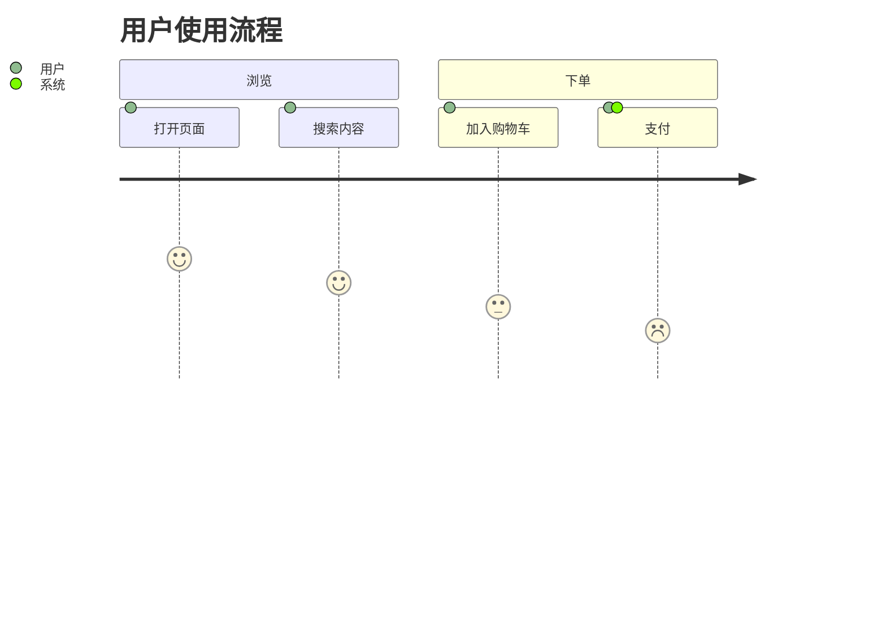

## 9. Git 图 GitGraph

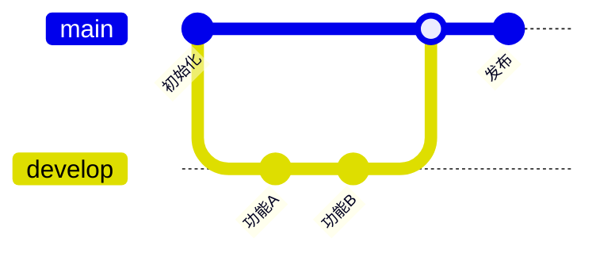

## 10. 思维导图 Mindmap

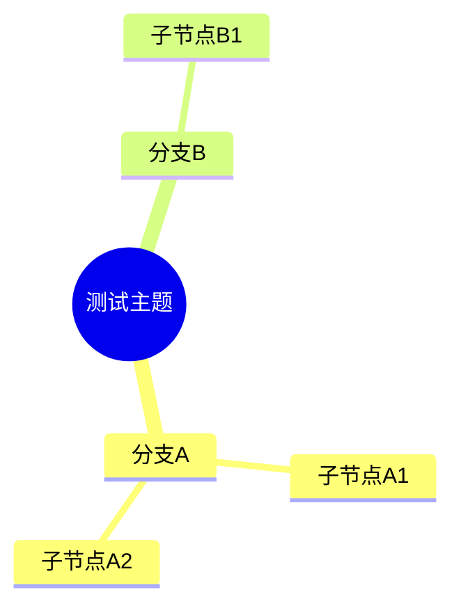

## 11. 时间线 Timeline

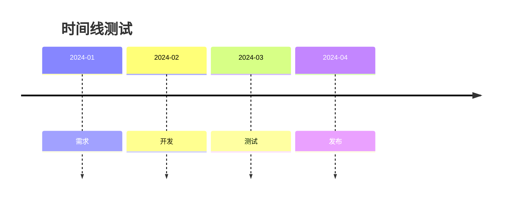

## 12. 测试完成

如果以上图表均能正常显示，则说明 Mermaid 基本图表支持正常。  
注意：`mindmap`、`timeline`、`journey`、`gitGraph` 等图类型对 Mermaid 版本有要求，若未显示，可优先检查渲染器版本。