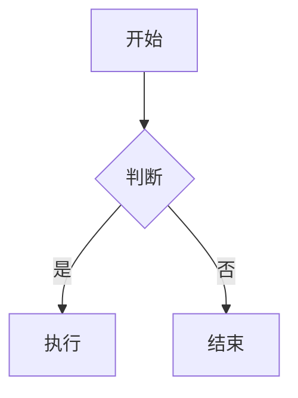

<!-- 这是一个 HTML 注释：文档从 YAML Front Matter 开始，属于常见扩展。 -->

# 一级标题 H1
## 二级标题 H2
### 三级标题 H3
#### 四级标题 H4
##### 五级标题 H5
###### 六级标题 H6

一级标题 Setext
================

二级标题 Setext
----------------

普通段落。包含 *斜体*、_斜体_、**粗体**、__粗体__、***粗斜体***、___粗斜体___、~~删除线~~、`行内代码`、<kbd>Ctrl</kbd>+<kbd>C</kbd>、<mark>高亮</mark>、H<sub>2</sub>O、x<sup>2</sup>、<ins>插入</ins>、<del>删除</del>。

这是同一段落中的软换行
第二行仍然属于同一段落。
这是硬换行（行尾两个空格）  
第二行在渲染中换行。

这是硬换行（反斜杠）\
第二行。

这是 HTML 换行：<br>
下一行。

> 引用块
> 
> 引用中的 **粗体**、*斜体*、`代码`、[链接](https://example.com)。
>
> > 嵌套引用
> >
> > - 列表项
> > - 列表项
>
> ```js
> console.log("引用中的代码块");
> ```

- 无序列表项 1
- 无序列表项 2
  - 嵌套项
    - 更深嵌套
- 无序列表项 3

+ 加号列表
* 星号列表

1. 有序列表项 1
2. 有序列表项 2
   1. 嵌套有序
   2. 嵌套有序
3. 有序列表项 3

1) 右括号有序列表
2) 第二项

3. 从 3 开始
4. 下一项

- [ ] 未完成任务
- [x] 已完成任务
- [ ] 嵌套任务
  - [x] 子任务完成

* [ ] 星号任务
+ [x] 加号任务

---

***

___

- - -

* * *

_ _ _

[行内链接](https://example.com "示例标题")
[相对链接](../README.md)
[空链接]()
[引用式链接][ref1]
[隐式引用式链接][]
[快捷引用式链接]
[末尾引用][endref]

[ref1]: https://example.com/ref1 "引用式标题"
[隐式引用式链接]: https://example.com/implicit
[快捷引用式链接]: https://example.com/shortcut
[endref]: https://example.com/end "末尾引用标题"

<https://example.com>
<user@example.com>
https://example.com 自动链接扩展
www.example.com 自动链接扩展
user@example.com 自动链接扩展


![引用式图片][img1]
[](https://example.com)

[img1]: https://example.com/image-ref.png "引用式图片标题"

| 左对齐 | 居中对齐 | 右对齐 | 默认 |
| :--- | :---: | ---: | --- |
| 单元格 | 单元格 | 单元格 | 单元格 |
| **粗体** | *斜体* | `代码` | [链接](https://example.com) |
| 长内容 | 长内容 | 长内容 | 长内容 |

| 无表头分隔线？ |
| --- |
| GFM 表格必须有分隔线 |

| 列 1 | 列 2 |
| --- | --- |
| 包含 \| 管道 | 正常 |

| 序号 | 名称 | 描述 | 状态 | 备注 |
| ---: | :--- | :---: | :---: | ---: |
| 1 | 项目 A | 描述 A | ✅ | 备注 A |
| 2 | 项目 B | 描述 B | ❌ | 备注 B |
| 3 | 项目 C | 描述 C | ⏳ | 备注 C |

```javascript
// 围栏代码块
function add(a, b) {
  return a + b;
}
```

~~~python
# 波浪线围栏代码块
def hello(name):
    print(f"Hello, {name}")
~~~

```html
<!DOCTYPE html>
<html lang="zh-CN">
<head>
  <meta charset="UTF-8">
  <title>HTML 代码块</title>
</head>
<body>
  <details>
    <summary>详情</summary>
    <p>内容</p>
  </details>
</body>
</html>
```

    // 缩进代码块（四个空格）
    const x = 1;
    console.log(x);

<details>
<summary>点击展开：HTML 与 Markdown 混合测试</summary>

### Details 内的 Markdown 标题

这是一个段落，包含 **粗体**、*斜体*、`代码`、[链接](https://example.com)。

- 列表项
- 列表项

```js
console.log("details 内代码块");
```

</details>

<details open>
<summary>默认展开的 Details</summary>

<p>这是一个 HTML 段落。</p>
<p>使用 <strong>HTML strong</strong> 和 <em>HTML em</em>。</p>

</details>

<div align="center">
  <h3>HTML div 居中</h3>
  <p></p>
</div>

<table>
  <thead>
    <tr><th>HTML 表头 1</th><th>HTML 表头 2</th></tr>
  </thead>
  <tbody>
    <tr><td>HTML 单元格 1</td><td>HTML 单元格 2</td></tr>
    <tr><td colspan="2">合并单元格</td></tr>
  </tbody>
</table>

<dl>
  <dt>术语 1</dt>
  <dd>定义 1</dd>
  <dt>术语 2</dt>
  <dd>定义 2</dd>
</dl>

<p>
  <abbr title="HyperText Markup Language">HTML</abbr>、
  <cite>引用来源</cite>、
  <q>短引用</q>、
  <time datetime="2026-10-12">2026 年 10 月 12 日</time>、
  <address>地址：示例市示例路 1 号</address>
</p>

<figure>
  
  <figcaption>图 1：HTML figure 与 figcaption</figcaption>
</figure>

<video controls width="320">
  <source src="https://example.com/video.mp4" type="video/mp4">
  <track kind="captions" src="https://example.com/captions.vtt" srclang="zh" label="中文">
  您的浏览器不支持 video 标签。
</video>

<audio controls>
  <source src="https://example.com/audio.mp3" type="audio/mpeg">
  您的浏览器不支持 audio 标签。
</audio>

<ruby>
  漢 <rp>(</rp><rt>hàn</rt><rp>)</rp>
  字 <rp>(</rp><rt>zì</rt><rp>)</rp>
</ruby>

<details>
<summary>嵌套 Details 外层</summary>
  <details>
  <summary>嵌套 Details 内层</summary>
  <p>嵌套内容</p>
  </details>
</details>

<!-- HTML 注释 -->

转义字符测试：
\*不是斜体\*
\_不是斜体\_
\`不是代码\`
\[不是链接\]
\# 不是标题
\+ 不是列表
\- 不是列表
\. 不是有序列表
\! 不是图片
\| 不是表格分隔符
\> 不是引用
\~ 不是删除线
\\ 反斜杠

实体测试：
&amp; &lt; &gt; &quot; &apos; &copy; &reg; &trade; &nbsp; &#169; &#x00A9; &hellip; &mdash; &ndash; &laquo; &raquo;

表情符号（GitHub 扩展）：
:smile: :heart: :rocket: :+1: :tada: :warning: :white_check_mark:

提及与 issue（GFM）：
@octocat
#123
GH-123
owner/repo#123

自动链接扩展：
https://github.com
http://example.com
ftp://example.com
mailto:user@example.com

脚注（扩展，非 GFM 核心）：
这是一个脚注引用[^1]，还有命名脚注[^note]。

[^1]: 这是脚注内容。
[^note]: 这是命名脚注内容，支持 **Markdown**。

定义列表（Markdown Extra / Pandoc 扩展）：
术语
: 定义

缩写：
*[HTML]: HyperText Markup Language

数学（扩展）：
$$
E = mc^2
$$

行内数学（扩展）：$a^2 + b^2 = c^2$

Mermaid 图（GitHub 扩展）：


任务列表嵌套：
- [x] 顶层完成
  - [ ] 子任务未完成
    - [x] 孙任务完成
- [ ] 顶层未完成

行内 HTML：
<span style="color: red;">红色文本</span>
<b>粗体</b>
<i>斜体</i>
<u>下划线</u>
<s>删除线</s>
<del>删除</del>
<ins>插入</ins>
<small>小字</small>
<strong>强调</strong>
<em>着重</em>
<code>行内 HTML 代码</code>
<kbd>Ctrl</kbd> + <kbd>Alt</kbd> + <kbd>Del</kbd>
<mark>高亮</mark>
<sub>下标</sub>
<sup>上标</sup>
<a href="https://example.com">HTML 链接</a>

HTML 块：
<div>
  <p>这是一个 HTML 块。</p>
  <ul>
    <li>HTML 列表项 1</li>
    <li>HTML 列表项 2</li>
  </ul>
</div>

<blockquote>
  <p>HTML 引用块。</p>
</blockquote>

<pre><code>HTML pre 代码块
第二行
</code></pre>

<hr>

<br>

<details>
<summary>HTML 表格与详情</summary>
<table>
  <tr><th>键</th><th>值</th></tr>
  <tr><td>键 1</td><td>值 1</td></tr>
</table>
</details>

空链接与图片：
[]()


链接标题中的引号：
[带标题](https://example.com "标题中的 \"引号\"")
[带单引号标题](https://example.com '单引号标题')
[带括号标题](https://example.com (括号标题))

URL 中的括号：
[复杂链接](https://example.com/path_(with)_parens)

嵌套强调：
**粗体中的 *斜体* 和 `代码`**
*斜体中的 **粗体** 和 ~~删除线~~*
***粗斜体中的 `代码`***

嵌套引用与列表：
> 1. 有序项
>    - 无序子项
>      ```js
>      console.log("嵌套代码");
>      ```
> 2. 有序项

嵌套列表中的代码块：
- 列表项
  ```python
  print("列表内代码块")
  ```
- 下一项

标题 ID（扩展）：
## 带自定义 ID 的标题 {#custom-id}

标题属性（扩展）：
## 带属性的标题 {.class #id data-key="value"}

段落属性（扩展）：
这是一个段落。
{.lead}

代码块属性（扩展）：
```js {.numberLines #example data-lang="javascript"}
console.log("带属性的代码块");
```

内联属性（扩展）：
[链接](https://example.com){.external target="_blank"}
`代码`{.inline-code}

Critic 标记（扩展）：
这是 {++新增++} 和 {--删除--} 以及 {~~旧~>新~~}。

高亮标记（扩展）：
==高亮文本==

下标与上标（扩展）：
H~2~O 和 x^2^

插入与删除（扩展）：
++插入++ 和 ~~删除~~

表情符号（Unicode）：
😀 😃 😄 😁 😆 😅 😂 🤣 😊 😇 🙂 🙃 😉 😌 😍 🥰 😘 😗 😙 😚 😋 😛 😝 😜 🤪 🤨 🧐 🤓 😎 🤩 🥳 😏 😒 😞 😔 😟 😕 🙁 😣 😖 😫 😩 🥺 😢 😭 😤 😠 😡 🤬 🤯 😳 🥵 🥶 😱 😨 😰 😥 😓 🤗 🤔 🤭 🤫 🤥 😶 😐 😑 😬 🙄 😯 😦 😧 😮 😲 🥱 😴 🤤 😪 😵 🤐 🥴 🤢 🤮 🤧 😷 🤒 🤕

长段落测试。Lorem ipsum dolor sit amet, consectetur adipiscing elit. Sed do eiusmod tempor incididunt ut labore et dolore magna aliqua. Ut enim ad minim veniam, quis nostrud exercitation ullamco laboris nisi ut aliquip ex ea commodo consequat. Duis aute irure dolor in reprehenderit in voluptate velit esse cillum dolore eu fugiat nulla pariatur. Excepteur sint occaecat cupidatat non proident, sunt in culpa qui officia deserunt mollit anim id est laborum.

中文长段落测试。这是一段较长的中文文本，用于测试 Markdown 解析器对中文换行、标点、强调、链接等元素的处理。中文之间通常没有空格，但 Markdown 的强调符号需要紧贴文字。例如：**这是粗体中文**、*这是斜体中文*、`这是行内代码中文`、[这是链接中文](https://example.com)。中文段落中的换行通常被视为软换行，渲染为空格或直接连接。如果需要在中文中强制换行，可以使用行尾两个空格或反斜杠，或者使用 HTML 的 `<br>` 标签。

<details>
<summary>点击展开：完整目录</summary>

1. [标题](#标题)
2. [段落与换行](#段落与换行)
3. [强调](#强调)
4. [列表](#列表)
5. [链接与图片](#链接与图片)
6. [表格](#表格)
7. [代码](#代码)
8. [引用](#引用)
9. [HTML](#html)
10. [扩展语法](#扩展语法)

</details>

<!-- 文档结束 -->